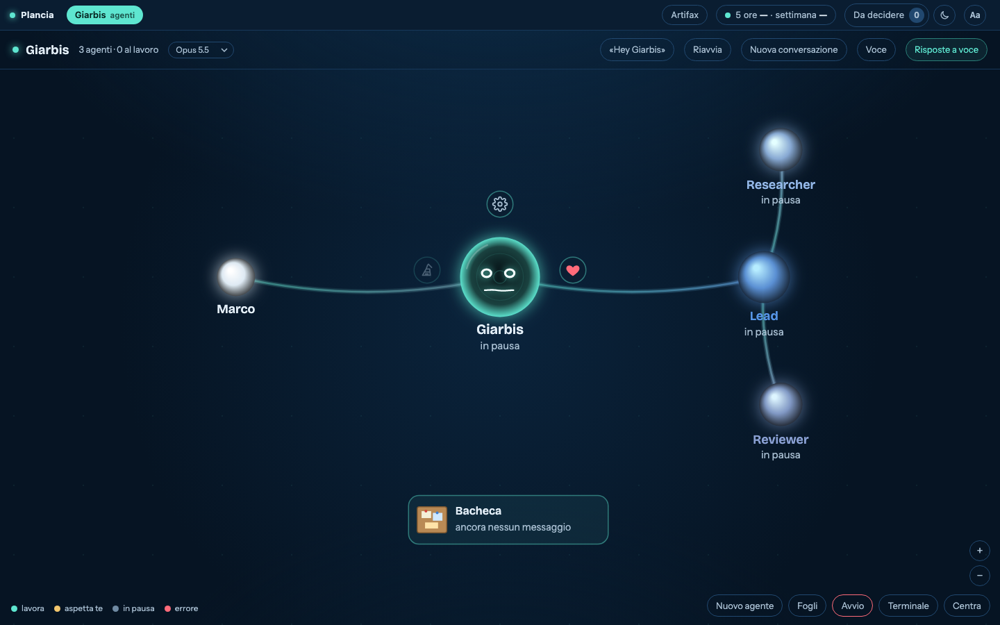

**English** · [Italiano](README.it.md)

# Giarbis

**A cockpit for Claude Code.** One page in your browser where an assistant works on your project with you and, when a job is long, hands it to other Claude Code agents running in parallel. You see all of them on a map: who is working, who is waiting for you, what they said. Type to them, or talk to them out loud.



It runs on your computer and uses your own Claude subscription. No extra paid key is needed.

## Install

You need Node.js 20 or newer, [Claude Code](https://docs.claude.com/en/docs/claude-code/setup) logged in to your account, and git.

```
npm install -g github:giuseppedolphin/giarbis
giarbis controlla
giarbis
```

`giarbis controlla` (Italian for "check") lists what is missing, with the fix next to each line. `giarbis`, run in your project folder, opens the page and an agent walks you through the setup, asking one question at a time and showing what it will write before it writes it. About five minutes.

## The squad

Besides the assistant you can have a **squad**: agents with a role, a written mandate and a metric, that wake up when there is something for them and report on a shared board. A lead, a researcher and a reviewer come as an example in `plancia/moduli/squadra-esempio/`. To try it, add this to `plancia.config.json`, then restart:

```json
"moduli": { "squadra-esempio": {} }
```

Open the **Squadra** panel and switch it on. Each role is a Claude Code session in your project; by default it reads and proposes, it does not change files. The README next to the example explains the two knobs (`permessi` and `autonomia`) and how to write your own mandates.

## What stays on your machine

- The server listens on `127.0.0.1` only. Everything it keeps (state, chats, notes, the board) is in `.plancia/` in your folder.
- **No telemetry, no analytics, no account.** The code makes no call of its own to any service, except the two below, which are off until you switch them on.
- Your keys stay in your own file, `.plancia/chiavi.env`. They are never written in a chat or in the config.
- Off by default: a natural voice (the text to read aloud goes to OpenAI or ElevenLabs, with your key) and a Telegram bot (with your token).
- Claude Code itself talks to Anthropic, as it does when you use it in a terminal. Giarbis does not change that.
- The page loads two small libraries and a font from public CDNs (cdnjs, Google Fonts); that is the browser asking, not Giarbis sending anything.

Agents can read and edit the files of the folder you start it in and run commands there, like Claude Code does, but they cannot stop to ask you: what would need your confirmation is refused. Run it on projects you would let Claude Code work on.

## Language

The interface, the prompts and the docs are in Italian for now; the assistant answers in the language you write to it. This README and the example squad are in English.

## More

[docs/architettura.md](docs/architettura.md) · [docs/primo-avvio.md](docs/primo-avvio.md) · the full Italian guide in [README.it.md](README.it.md).

MIT licence, see [LICENSE](LICENSE).
